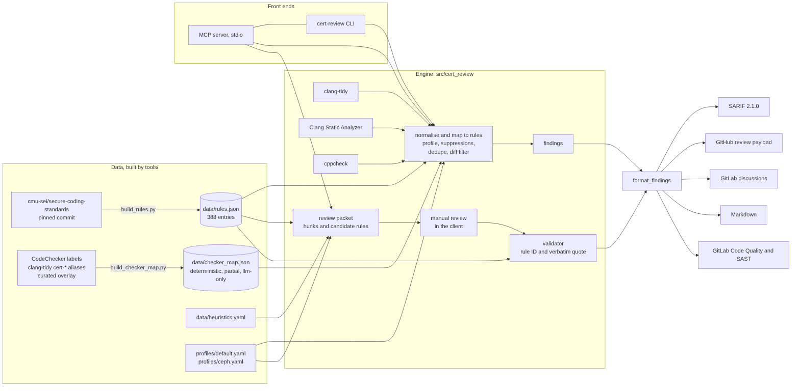

# cert-review-mcp

[](https://glama.ai/mcp/servers/RaminNietzsche/cert-review-mcp)

SEI CERT C and C++ code review as an MCP server, a CLI and two review skills,
tuned for [Ceph](https://github.com/ceph/ceph).

It does three things:

1. **Knows the standards.** `data/rules.json` holds every rule and recommendation of the
   SEI CERT C standard (122 rules, 183 recommendations) and every rule of the SEI CERT C++
   standard (83 rules), with paired noncompliant/compliant examples, the risk row
   (severity, likelihood, detectable, repairable, priority, level), CWE tags and the
   automated-detection tables. It is built reproducibly from a pinned upstream commit and
   checked against the standards' own index pages.
2. **Runs real analyzers and maps them to rule IDs.** clang-tidy (`cert-*` and mapped checks),
   the Clang Static Analyzer, cppcheck and 40 bundled Semgrep rules for INT, EXP, MEM, CON and
   other CERT rules; optionally Infer and the CodeQL CERT query packs
   ([docs/analyzers.md](docs/analyzers.md)). Findings are normalised to one schema,
   de-duplicated, filtered by a profile, and optionally limited to changed lines.
3. **Prepares the rest for a manual review layer without letting it make things up.** For rules
   no checker covers, `build_review_packet` selects code hunks and the few rule texts worth reading;
   `validate_findings` rejects any finding that does not cite an existing rule ID and quote
   that rule's text.

Comments are only drafted and formatted. **Nothing is ever posted** to GitHub or GitLab by this
project.

> Not an official CERT or CMU product. See [NOTICE](NOTICE) for attribution (CC BY 4.0 text,
> MIT examples) and the pinned source commit.

## Architecture



The diagram source is in [docs/architecture.md](docs/architecture.md).

## Coverage

Each rule is `deterministic` (a rule-specific checker exists: a clang-tidy `cert-*` check or a
CodeQL CERT query), `partial` (only general checkers or the bundled Semgrep pattern rules map)
or `llm-only` (no checker). The *reference toolchain* is what the Docker images run:
clang-tidy/clang 19.1.7, cppcheck 2.17.1 and Semgrep 1.186.0 with the bundled rules. The
*extended toolchain* adds Infer 1.3.0 and CodeQL 2.27 with the CERT packs 2.63.0, which are
optional and not in the images.

| Set | Total | All mappings: det / partial / llm-only | Reference toolchain | Extended toolchain |
|---|---|---|---|---|
| C rules | 122 | 100 / 12 / 10 | 16 / 51 / 55 | 100 / 8 / 14 |
| C recommendations | 183 | 4 / 4 / 175 | 4 / 2 / 177 | 4 / 3 / 176 |
| C++ rules | 83 | 82 / 0 / 1 | 18 / 31 / 34 | 82 / 0 / 1 |

Before the Semgrep rules, the reference toolchain covered C rules 16 / 34 / 72 and C++ rules
18 / 29 / 36. A mapped checker is not a detection guarantee; the measured numbers follow.

Measured precision and recall on the CERT examples: [docs/accuracy.md](docs/accuracy.md).
Rule counts versus the official index pages: [docs/rule-counts.md](docs/rule-counts.md).
Results on a real Ceph subtree: [docs/ceph-trial.md](docs/ceph-trial.md).

## Install

```bash
git clone <this repository> cert-review-mcp && cd cert-review-mcp
python3 -m venv .venv && . .venv/bin/activate
pip install -e '.[dev]'
sudo apt-get install clang clang-tidy cppcheck       # static layer (optional but recommended)
pip install semgrep==1.186.0                        # optional: the bundled CERT pattern rules
pytest                                              # 129 tests
```

The package reads `data/` and `profiles/` from the checkout (set `CERT_REVIEW_HOME` to point
elsewhere). Python 3.11+; works with the official `mcp` SDK 1.x (`FastMCP`, 1.15 or later) and 2.x (`MCPServer`).

### Cursor

`.cursor/mcp.json` in your project (or `~/.cursor/mcp.json`):

```json
{
  "mcpServers": {
    "cert-review": {
      "command": "/path/to/cert-review-mcp/.venv/bin/cert-review-mcp",
      "env": { "CERT_REVIEW_HOME": "/path/to/cert-review-mcp" }
    }
  }
}
```

Then ask: "Use the cert-review `ceph_review` prompt on my current diff." Copy `skills/` into your
skills folder to make the review procedure available.

### Docker

`Dockerfile.mcp` builds the MCP server with the analyzers included (no local clang or
cppcheck needed). Mount your project at the same absolute path it has on the host:

```bash
docker build -f Dockerfile.mcp -t cert-review-mcp .
```

```json
{
  "mcpServers": {
    "cert-review": {
      "command": "docker",
      "args": ["run", "-i", "--rm", "-v", "/home/me/proj:/home/me/proj:ro", "cert-review-mcp"]
    }
  }
}
```

The same `mcpServers` block works in Claude Desktop and Cursor. Release tags also publish
multi-arch images (amd64, arm64) to Docker Hub as
[`raminnietzsche/cert-review-mcp`](https://hub.docker.com/r/raminnietzsche/cert-review-mcp);
use `raminnietzsche/cert-review-mcp:latest` instead of `cert-review-mcp` to skip the build.
Details, the CLI from the image, and a `tools/list` check: [docs/docker.md](docs/docker.md).

### MCP Registry

The server is listed in the official [MCP Registry](https://registry.modelcontextprotocol.io)
as `io.github.RaminNietzsche/cert-review-mcp` ([server.json](server.json)), so clients that read
the registry can install the Docker image from there.

### Claude Code

```bash
claude mcp add cert-review -- /path/to/cert-review-mcp/.venv/bin/cert-review-mcp
mkdir -p ~/.claude/skills && cp -r skills/cert-review skills/ceph-cert-review ~/.claude/skills/
```

## Use as a GitHub Action

```yaml
- uses: actions/checkout@v4
  with: { fetch-depth: 0 }
- uses: RaminNietzsche/cert-review-mcp@v1
  with:
    profile: default            # or ceph
    fail-on: error
    upload-sarif: "true"        # SARIF to code scanning
```

Diff mode on pull requests, SARIF, a job summary, and optional inline review comments
(`review-comments: "true"`, off by default). A GitLab include template publishes Code Quality
and SAST reports. Inputs, outputs and examples: [docs/action.md](docs/action.md),
[examples/github-workflow.yml](examples/github-workflow.yml).

## MCP tools

Every tool is read-only: it reads local files and bundled data and runs local analyzers.
Nothing is written, uploaded or posted. All tools declare MCP annotations, a title and,
except `format_findings`, an output schema.

For `check_diff` and `build_review_packet` with pasted `diff_text`, files that are missing on
the MCP host are reconstructed from the patch under `repo` (the directory is created when needed).
On remote servers that cannot see your checkout, pass the unified diff and a logical root path
(for example `/workspace/ceph`); omit `repo` to use a disposable tree under the system temp
directory.

| Tool | Purpose |
|---|---|
| `list_rules(lang, category, kind, level, detectable, coverage, limit)` | Filter the rule database; summaries with coverage tier |
| `search_rules(query, limit, lang)` | Rank rules by keyword relevance (API names, concepts, IDs) |
| `get_rule(rule_id, profile, include_examples)` | One rule: text, examples, risk row, CWE, checkers, profile notes |
| `get_rule_coverage(lang, kind, include_ids)` | Rule counts per tier: deterministic / partial / llm-only |
| `check_files(path, profile, compdb, root, lang, tools, ...)` | Analyzer findings for a file or a directory tree |
| `check_diff(repo, base, head \| diff_text, profile, compdb, ...)` | Analyzer findings on changed lines only |
| `build_review_packet(path \| repo + base \| diff_text, ...)` | Code hunks plus candidate rule texts for manual review |
| `validate_findings(findings, packet, profile)` | Accept only grounded findings (rule ID + verbatim quote) |
| `format_findings(findings, style, root, warnings)` | `markdown`, `github`, `gitlab`, `sarif`, `codequality` or `gitlab-sast`; formatting only |

MCP tool and parameter names changed after the `v1` release; see [CHANGELOG.md](CHANGELOG.md).

Resources: `rule://EXP34-C`, `profile://ceph`. Prompts: `cert_review`, `ceph_review`.

## CLI

```bash
cert-review check src/common/Throttle.cc --profile ceph --compdb build --format markdown
cert-review diff --repo ~/ceph --base origin/main --profile ceph --format sarif -o out.sarif
cert-review diff --diff-file change.patch --format github > review.json   # payload only
cert-review explain EXP34-C
cert-review coverage --lang cpp
cert-review rules --lang cpp --coverage llm-only
cert-review packet --repo ~/ceph --base origin/main --profile ceph -o packet.json
cert-review validate findings.json --packet packet.json
```

`--fail-on error|warning|note` sets the exit code for CI. Silence one rule on a line with
`// cert-review: ignore EXP34-C reason`.

## Profiles

`profiles/default.yaml` is plain CERT. `profiles/ceph.yaml` encodes Ceph: C++23/C11,
priority and severity per rule, suppressions with reasons (ceph_assert, dout, crimson,
tests, vendored trees), and idioms (bufferlist, `ceph::mutex`, `RefCountedObject`, errno
returns, asio/seastar callbacks) that tell the reviewer how each project construct
changes a rule. Evidence for each idiom is cited inside the file.

## Rebuilding the data

```bash
git clone https://github.com/cmu-sei/secure-coding-standards cert-src
python3 tools/build_rules.py --src cert-src            # fails if counts differ from the index pages
python3 tools/build_checker_map.py --codechecker <codechecker clone> --llvm <llvm-project clone>
python3 tools/build_corpus.py && python3 tools/eval_accuracy.py
python3 tools/ceph_compdb.py --ceph ~/ceph --out /tmp/ceph-compdb src/common   # cheap compile db
```

## Limitations

- Static coverage is thin by nature: most CERT rules are not decidable by tools; the
  `llm-only` and `partial` rules depend on the review layer and on a human.
- Tools need compilable code. Without `compile_commands.json` many files do not parse and
  checks are skipped. The engine reports this instead of "no findings": the tool status
  becomes `partial`, the markdown, SARIF (`executionSuccessful: false` plus a
  `toolExecutionNotifications` warning), GitHub review, Action summary and CLI output carry a
  warning, and `--fail-on-parse-error` (alias `--fail-on-partial`; Action input
  `fail-on-parse-error`) turns it into a failing exit code. A file on which an analyzer hits
  its 300 s timeout is treated the same way.
- **Ceph needs Linux.** Its sources include Linux-only headers (`linux/version.h`, ...) and
  Linux-only Boost.Asio features, so e.g. `src/rgw/radosgw-admin/radosgw-admin.cc` cannot be
  parsed on macOS even with the SDK sysroot and Homebrew Boost. Analyse Ceph on Linux, with the
  Docker image, or with the GitHub Action. `tools/ceph_compdb.py` adds `-isysroot` on macOS, which
  is enough for some directories (`src/common`) but not for all of them.
- Mappings come from CodeChecker labels and clang-tidy aliases plus a small curated overlay;
  general analyzers can map to several rules, so the engine keeps the best few per line.
- Ceph's profile is based on reading the code and on a limited trial, not on a full build.

## License

Code: Apache-2.0 ([LICENSE](LICENSE)). Bundled CERT content: CC BY 4.0 (text) and MIT
(examples); see [NOTICE](NOTICE).
