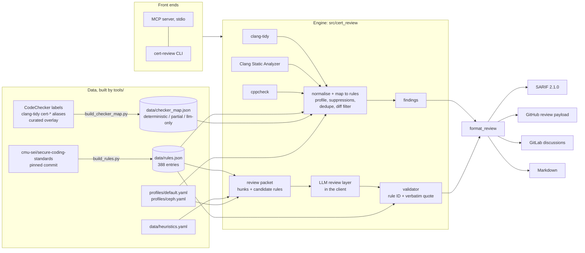

# cert-review-mcp

SEI CERT C and C++ code review as an MCP server, a CLI and two review skills,
tuned for [Ceph](https://github.com/ceph/ceph).

It does three things:

1. **Knows the standards.** `data/rules.json` holds every rule and recommendation of the
   SEI CERT C standard (122 rules, 183 recommendations) and every rule of the SEI CERT C++
   standard (83 rules), with paired noncompliant/compliant examples, the risk row
   (severity, likelihood, detectable, repairable, priority, level), CWE tags and the
   automated-detection tables. It is built reproducibly from a pinned upstream commit and
   checked against the standards' own index pages.
2. **Runs real analyzers and maps them to rule IDs.** clang-tidy (`cert-*` and mapped checks),
   the Clang Static Analyzer and cppcheck, normalised to one finding schema, de-duplicated,
   filtered by a profile, and optionally limited to changed lines.
3. **Prepares the rest for an LLM review layer without letting it make things up.** For rules
   no checker covers, `review_packet` selects code hunks and the few rule texts worth reading;
   `validate_findings` rejects any finding that does not cite an existing rule ID and quote
   that rule's text.

Comments are only drafted and formatted. **Nothing is ever posted** to GitHub or GitLab by this
project.

> Not an official CERT or CMU product. See [NOTICE](NOTICE) for attribution (CC BY 4.0 text,
> MIT examples) and the pinned source commit.

## Architecture



## Coverage

Each rule is `deterministic` (a rule-specific checker exists, i.e. a clang-tidy `cert-*`
check), `partial` (only general checkers are mapped) or `llm-only` (no checker). "Runnable"
counts only checkers present in the supported toolchain (clang-tidy/clang 19.1.7, cppcheck 2.17.1).

| Set | Total | Deterministic | Partial | LLM-only | Runnable: det / partial / llm-only |
|---|---|---|---|---|---|
| C rules | 122 | 18 | 53 | 51 | 16 / 34 / 72 |
| C recommendations | 183 | 4 | 3 | 176 | 4 / 2 / 177 |
| C++ rules | 83 | 18 | 37 | 28 | 18 / 29 / 36 |

Measured precision and recall on the CERT examples: [docs/accuracy.md](docs/accuracy.md).
Rule counts versus the official index pages: [docs/rule-counts.md](docs/rule-counts.md).
Results on a real Ceph subtree: [docs/ceph-trial.md](docs/ceph-trial.md).

## Install

```bash
git clone <this repository> cert-review-mcp && cd cert-review-mcp
python3 -m venv .venv && . .venv/bin/activate
pip install -e '.[dev]'
sudo apt-get install clang clang-tidy cppcheck       # static layer (optional but recommended)
pytest                                              # 80 tests
```

The package reads `data/` and `profiles/` from the checkout (set `CERT_REVIEW_HOME` to point
elsewhere). Python 3.11+; works with the official `mcp` SDK 1.x (`FastMCP`) and 2.x (`MCPServer`).

### Cursor

`.cursor/mcp.json` in your project (or `~/.cursor/mcp.json`):

```json
{
  "mcpServers": {
    "cert-review": {
      "command": "/path/to/cert-review-mcp/.venv/bin/cert-review-mcp",
      "env": { "CERT_REVIEW_HOME": "/path/to/cert-review-mcp" }
    }
  }
}
```

Then ask: "Use the cert-review `ceph_review` prompt on my current diff." Copy `skills/` into your
skills folder to make the review procedure available.

### Claude Code

```bash
claude mcp add cert-review -- /path/to/cert-review-mcp/.venv/bin/cert-review-mcp
mkdir -p ~/.claude/skills && cp -r skills/cert-review skills/ceph-cert-review ~/.claude/skills/
```

## MCP tools

| Tool | Purpose |
|---|---|
| `list_rules(lang, category, kind, level, detectable, coverage)` | Browse the rules and their coverage tier |
| `explain_rule(id, profile)` | Full text, examples, risk row, CWE, detection tools, profile notes |
| `search_rules(query)` | Keyword search over titles, text and examples |
| `check_file(path, profile, lang, compdb, ...)` | Static findings for files or directories |
| `check_diff(repo, base, head \| diff_text, profile)` | Static findings on changed lines only |
| `review_packet(...)` | Hunks plus candidate rule texts for the LLM layer |
| `validate_findings(findings_json)` | Accept only grounded findings (rule ID + verbatim quote) |
| `rule_coverage(lang)` | Deterministic / partial / llm-only counts |
| `format_review(findings, style)` | `github`, `gitlab`, `sarif` or `markdown`; formatting only |

Resources: `rule://EXP34-C`, `profile://ceph`. Prompts: `cert_review`, `ceph_review`.

## CLI

```bash
cert-review check src/common/Throttle.cc --profile ceph --compdb build --format markdown
cert-review diff --repo ~/ceph --base origin/main --profile ceph --format sarif -o out.sarif
cert-review diff --diff-file change.patch --format github > review.json   # payload only
cert-review explain EXP34-C
cert-review coverage --lang cpp
cert-review rules --lang cpp --coverage llm-only
cert-review packet --repo ~/ceph --base origin/main --profile ceph -o packet.json
cert-review validate findings.json --packet packet.json
```

`--fail-on error|warning|note` sets the exit code for CI. Silence one rule on a line with
`// cert-review: ignore EXP34-C reason`.

## Profiles

`profiles/default.yaml` is plain CERT. `profiles/ceph.yaml` encodes Ceph: C++23/C11,
priority and severity per rule, suppressions with reasons (ceph_assert, dout, crimson,
tests, vendored trees), and idioms (bufferlist, `ceph::mutex`, `RefCountedObject`, errno
returns, asio/seastar callbacks) that tell the reviewer how each project construct
changes a rule. Evidence for each idiom is cited inside the file.

## Rebuilding the data

```bash
git clone https://github.com/cmu-sei/secure-coding-standards cert-src
python3 tools/build_rules.py --src cert-src            # fails if counts differ from the index pages
python3 tools/build_checker_map.py --codechecker <codechecker clone> --llvm <llvm-project clone>
python3 tools/build_corpus.py && python3 tools/eval_accuracy.py
python3 tools/ceph_compdb.py --ceph ~/ceph --out /tmp/ceph-compdb src/common   # cheap compile db
```

## Limitations

- Static coverage is thin by nature: most CERT rules are not decidable by tools; the
  `llm-only` and `partial` rules depend on the review layer and on a human.
- Tools need compilable code. Without `compile_commands.json` many files do not parse and
  checks are skipped; the engine reports parse errors instead of "no findings".
- Mappings come from CodeChecker labels and clang-tidy aliases plus a small curated overlay;
  general analyzers can map to several rules, so the engine keeps the best few per line.
- Ceph's profile is based on reading the code and on a limited trial, not on a full build.

## License

Code: Apache-2.0 ([LICENSE](LICENSE)). Bundled CERT content: CC BY 4.0 (text) and MIT
(examples); see [NOTICE](NOTICE).
